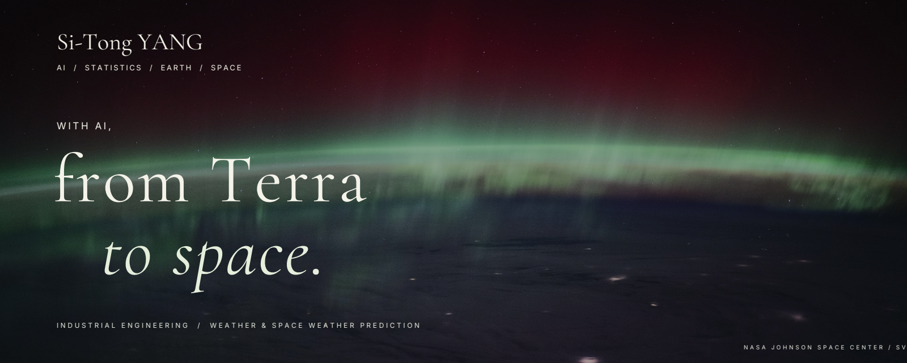

**PhD student in Industrial Engineering · Clemson University**

I use statistics and machine learning, with a particular focus on **flow matching**, to forecast **terrestrial weather and space weather**. My interests span spatiotemporal modeling, the ionosphere, and the thermosphere.

[Research](#research) · [Methods](#methods) · [Code](https://github.com/phoenix102030?tab=repositories) · [Connect](#connect)

---

### Research

- **Terrestrial weather** — statistical and machine learning approaches to atmospheric forecasting.
- **Space weather** — prediction in near-Earth space, including the ionosphere and thermosphere.

### Methods

Flow matching · Statistical learning · Scientific machine learning · Spatiotemporal modeling · Uncertainty quantification

### Code & tools

Python · PyTorch · MATLAB · C++ · Git · Linux · Docker

[Browse my repositories →](https://github.com/phoenix102030?tab=repositories)

### Connect

I'm open to research conversations and collaborations around scientific machine learning and geophysical forecasting.

[ORCID](https://orcid.org/0009-0001-2975-2041) · [LinkedIn](https://www.linkedin.com/in/sitongyang/)

Clemson, South Carolina, USA

<!-- Add the personal website URL after it is publicly hosted. Do not link localhost. -->
<!-- Add verified Google Scholar, ResearchGate, and public email links when provided. -->
<!-- Replace the repositories link with selected original research projects once selected. -->

---

Banner imagery: Earth Science and Remote Sensing Unit, NASA Johnson Space Center. [Original imagery and credits · NASA SVS](https://svs.gsfc.nasa.gov/31375/).
